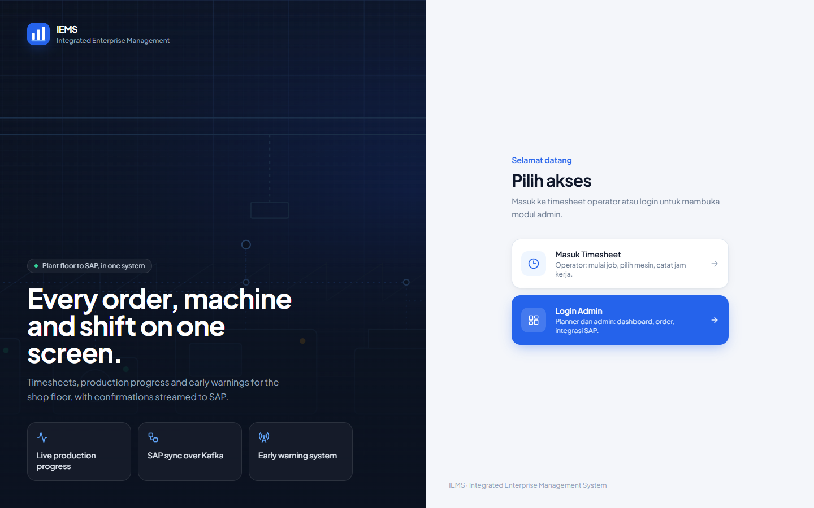
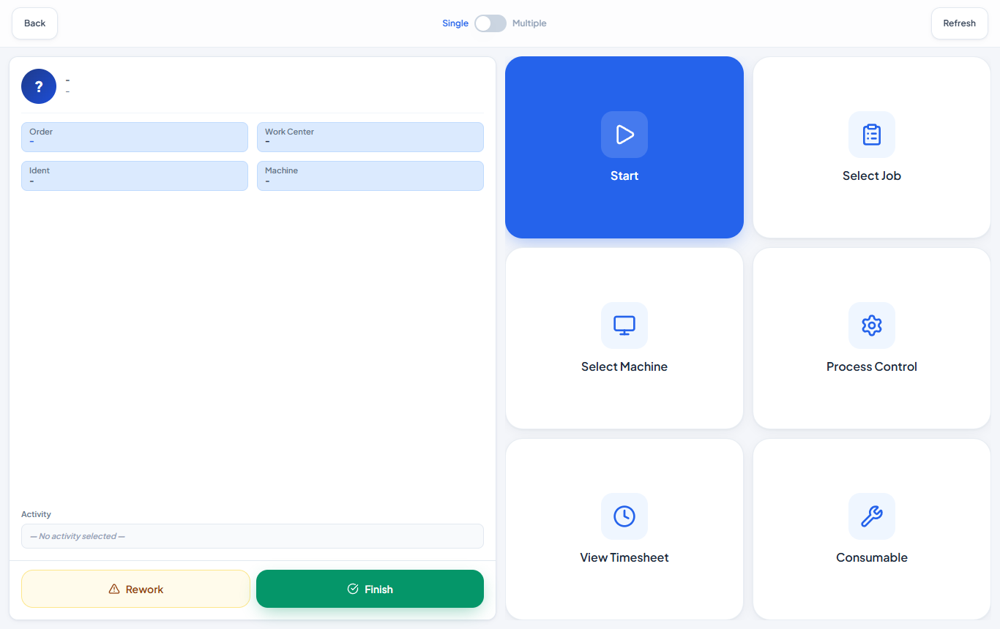
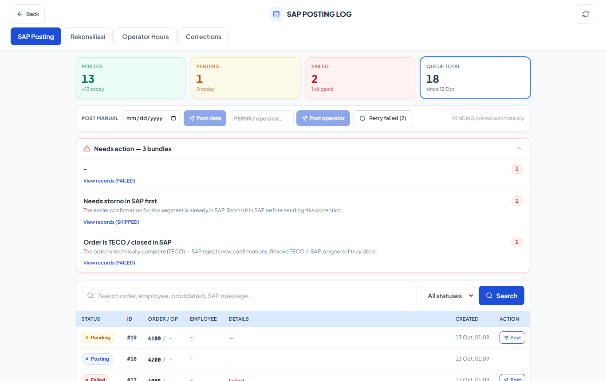
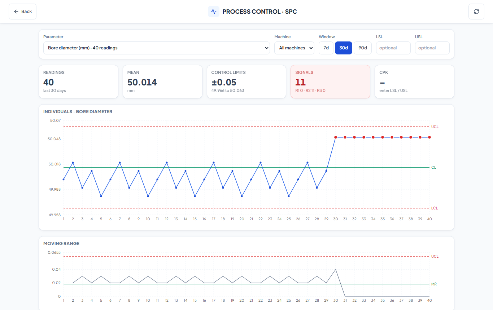

# IEMS: Integrated Enterprise Management System

[](https://github.com/Javanian/IEMS/actions/workflows/ci.yml)

A production planning and execution platform for a heavy-equipment manufacturer, used daily across 4 plant sites. It brings labor time, machine hours, work-order (SOW) and bay scheduling, early-warning monitoring, and automated posting to SAP S/4HANA into one system.

I designed and built it alone as the company's only internal developer: architecture, frontend, backend, database, infrastructure and the SAP integration.

> This is a curated public snapshot of the production codebase. Credentials, plant data exports, internal planning notes and non-runtime tooling are excluded, so the repository does not run against real plant systems as published.

## What it does

| Area | Capabilities |
| --- | --- |
| Labor timesheet | NFC-card login, check-in and check-out per job operation, hierarchical validation, Excel export |
| Machine hours | ETL from factory SQL Server and HMI sources: segment splitting, normalization, bundling per shift, validation |
| SOW and bay scheduling | Order pool, bay reservations on an area map and timeline, NFC confirmation, sub-operation progress |
| Early Warning System | Periodic OEE, OLE and adoption snapshots, tablet uptime from kiosk heartbeats and HMI uptime from ping logs, threshold-based issue detection, real-time notifications over SSE, local text-to-speech voice alerts on the shop floor |
| SAP integration | Staging of timesheet records and machine-hour bundles, automatic posting, retry, correction and an operations queue UI. Optional Kafka transport for SAP orders into every plant and for confirmations back to SAP |
| Component tracking | Buffer transactions, receiving and shipment, consumables and tools, kanban |
| Process control and SPC | Process parameters recorded per job, I-MR control charts with Nelson rules 1 to 3, Cp and Cpk against optional specification limits |
| Dashboards | Active orders, TECO, machine productive time, pending validation, OEE and OLE |

## Screenshots

Captured from a local run with sample data.

| Sign-in | Operator kiosk (timesheet) |
| --- | --- |
|  |  |
| **SAP posting log** | **SPC dashboard** |
|  |  |

## Architecture

<picture>
  <source media="(prefers-color-scheme: dark)" srcset="docs/diagrams/iems-architecture-dark.svg">
  
</picture>

The Kafka paths (dashed, through the two topics) run only with the `kafka` profiles. The [interactive version](docs/diagrams/iems-architecture.html) lists the source lines behind every box; download it and open it in a browser.

Each plant runs its own stack of 16 services, plus the Kafka workers when the `kafka` profile is enabled. All frontend assets are bundled locally, so the application works on a factory LAN without internet access.

```text
apps/
  web/                React 19 + Vite 7 + Tailwind 3 (PWA, offline-first)
  api/                Node.js / Express REST API
  fastapi-msproject/  FastAPI service for MS Project synchronization
  tts-worker/         Python text-to-speech worker (Piper)
jobs/
  etl/                Machine-hours ETL from SQL Server
  sap_staging/        SAP pipeline: stage, post, operations queue, Kafka relay and poster
  messaging/          Kafka envelope, topics, producer/consumer helpers, tests
  sow/                SOW seed and export
  machine_ping/       Machine heartbeat worker
database/
  migrate.js          Migration runner
  migrations/         SQL migrations (api, deferred, legacy)
infra/nginx/          Reverse proxy configuration
docker-compose.yml    Production stack
```

## Engineering highlights

- Hours cannot reach payroll twice. Every bundle records which source segments it came from, a partial unique index lets each segment be POSTED only once, and a trigger freezes source fields once they were sent. Retries run only for network failures, never for SAP business rejections, so a retry after a lost response is safe.
- SAP traffic can run over Kafka ([design notes](jobs/messaging/README.md)). Confirmations are keyed by production order, so the order lock in SAP CPI is respected by partitioning instead of locking code, and adding poster replicas adds throughput. Messages carry a row reference and payload hash, so late or duplicate deliveries are dropped. SAP orders go to a compacted topic that each plant consumes at its own pace and can replay from the start.
- Posting is split into separate stage, post and ops workers, with correction and an operations queue exposed in the web UI.
- Machine-hour ETL turns raw HMI segments into per-shift bundles before they reach validation and SAP.
- The API connects through PgBouncer, which pools connections in front of the PostgreSQL instance that the API and background workers share.
- The web app follows one design system ([design-system/iems/MASTER.md](design-system/iems/MASTER.md)): colors are CSS-variable tokens instead of raw hex, all fonts ship with the bundle so the app renders the same on an offline factory LAN, and CI rejects raw hex colors in classes.
- Voice alerts are generated locally with Piper, so the early-warning system does not depend on a cloud TTS service.
- The SPC page estimates sigma from the average moving range rather than the overall standard deviation, so control limits stay tight when the process drifts, which is when the chart has to react.

### Lifecycle of an SAP confirmation

Each staged row moves through these states. The claim into `POSTING` is a single `UPDATE`, so two workers never post the same row, and the guards turn a would-be duplicate into `SKIPPED` instead of a second payroll entry.

<picture>
  <source media="(prefers-color-scheme: dark)" srcset="docs/diagrams/sap-confirmation-lifecycle-dark.svg">
  
</picture>

### SAP pipeline, script by script

**Part 1, machine data to the staging queue.** `etl_machine_conf.py` copies HMI segments from SQL Server into `mch_productiondata`, `etl_mch_transaction_v3.py` resolves operator, order and status into `mch_transaction`, and the `sap-stage-worker` runs `stage_machinehours.py` to bundle eligible rows per day into `sap_timesheet_staging`, recording which source segments each bundle covers.

<picture>
  <source media="(prefers-color-scheme: dark)" srcset="docs/diagrams/sap-pipeline-staging-dark.svg">
  
</picture>

**Part 2, staging queue to SAP.** `post_sap_staging.py` claims rows, checks two guards against `sap_staging_source` and `log_timesheet_sap`, and posts to SAP CPI. With `SAP_TRANSPORT=kafka`, `sap_kafka_relay.py` and `sap_kafka_poster.py` take that path through `sap.confirmations.v1`. Buttons on the SAP Log page only queue a request; `ops_worker.py` runs the script.

<picture>
  <source media="(prefers-color-scheme: dark)" srcset="docs/diagrams/sap-pipeline-posting-dark.svg">
  
</picture>

Diagrams are generated from the specs in [docs/diagrams](docs/diagrams), each pinned to the commit it was traced from. The HTML versions there list the file and line range behind every box; download one and open it in a browser.

## Tech stack

| Layer | Technologies |
| --- | --- |
| Frontend | React 19, Vite 7, Tailwind CSS 3 with design tokens, Plus Jakarta Sans and Fira Code bundled locally, React Router, ECharts, Recharts, dnd-kit, vite-plugin-pwa |
| Backend | Node.js 18+, Express 4, FastAPI |
| Data | PostgreSQL 15, PgBouncer, SQL Server (ETL source) |
| Messaging | Apache Kafka (KRaft), confluent-kafka (librdkafka) with idempotent producers, compacted topics, dead-letter topics |
| Workers | Python: ETL, SAP staging and posting, Kafka producers and consumers, Piper TTS |
| Infrastructure | Docker Compose, Nginx with TLS, Linux |
| Integration | SAP S/4HANA through SAP CPI, MS Project |

## Development setup

```bash
# Dependencies
cd apps/web && npm install
cd ../api && npm install
cd ../..

# Environment
cp .env.example .env            # then adjust values

# Database and connection pooler
docker compose up -d db pgbouncer
node database/migrate.js

# API (port 3001) and web (port 5173), in two terminals
cd apps/api && npm run dev
cd apps/web && npm run dev
```

Production deployment per site:

```bash
docker compose up -d --build

# Optional: Kafka broker, SAP confirmation relay and poster, order consumer
docker compose --profile kafka up -d --build
```

ETL and SAP workers are configured through environment variables listed in `.env.example`.

## Tests

GitHub Actions runs four jobs on every push: API unit tests (`node --test`), the web production build, Python unit tests, and an end-to-end test of the Kafka pipeline against real `apache/kafka` and PostgreSQL containers.

The end-to-end test replaces SAP CPI with a local HTTP server. It checks that every confirmation reaches SAP exactly once across three competing posters, that no two confirmations for one order are in flight together, that rows of one order arrive in order, and that replayed, unparsable and in-flight messages post nothing. See [jobs/messaging/README.md](jobs/messaging/README.md#tests) to run it locally.

## Limitations of this snapshot

- Automated tests cover the SAP messaging path, SPC statistics and selected units. Most API routes and UI pages have no automated tests.
- Workers that talk to SQL Server, SAP CPI or MS Project need real endpoints and credentials, which are not included.
- The user interface mixes Indonesian and English labels.

## License

All rights reserved. The code is published for demonstration; production data and internal configuration are not included.

## Author

Tee San ([Javanian](https://github.com/Javanian)) · Full-stack developer and data engineer · [Portfolio](https://porto.hillteo.com) · [teesanfajar@gmail.com](mailto:teesanfajar@gmail.com)
