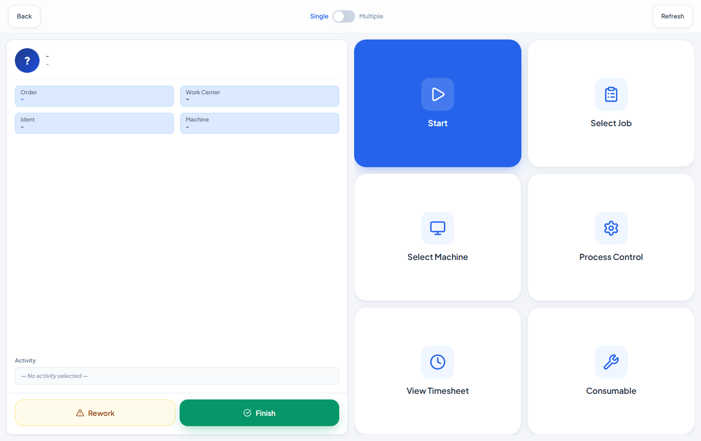

<div align="center">


# IEMS: Integrated Enterprise Management System

**Factory software that records who worked on which job, for how long, and how long each machine ran, then sends those hours to SAP without anyone typing them in again.**

[](https://github.com/Javanian/IEMS/actions/workflows/ci.yml)
[](https://github.com/Javanian/IEMS/actions/workflows/release.yml)
[](https://github.com/Javanian/IEMS/releases)
[](LICENSE)
[](docs/ai-assisted-development.md)

[What it does](#what-it-does) · [Screenshots](#screenshots) · [Architecture](#architecture) · [Engineering notes](#engineering-notes) · [How it was built](#how-it-was-built) · [Run it](#run-it)

</div>

## The problem

A heavy-equipment plant has three records of the same day's work. The operator writes hours on a paper timesheet. The machine's HMI logs its own run time in a separate SQL Server database. A planner keeps the bay schedule in a spreadsheet. At the end of the week a supervisor types the confirmed hours into SAP by hand, and that is where hours go missing, get counted twice, or land on the wrong order.

IEMS replaces that with one system that runs on the factory LAN:

1. The operator taps an NFC badge on a shop-floor tablet and starts the job operation.
2. Machine run time comes in automatically from the HMI database and is split per shift.
3. A supervisor validates the hours on screen.
4. IEMS posts the confirmed hours to SAP S/4HANA. If SAP rejects a row, it shows up in a queue with the reason and a retry button.

It also tracks bay schedules, component stock and process measurements, and it calls out problems on the shop floor with a local voice: an HMI that stopped answering pings, a machine or operator below its OEE or OLE target, machine hours with no operator attached.

I designed and built it alone: database, API, web app, workers, Docker setup and the SAP integration. I built it with AI coding agents under my direction; [How it was built](#how-it-was-built) explains the workflow.

> [!NOTE]
> This is my own version of the system, published as a portfolio. It contains no customer data or credentials, so the workers that talk to SQL Server, SAP CPI or MS Project need your own endpoints to do anything.

## At a glance

| | |
| :--- | :--- |
| Deployment | One self-contained Docker Compose stack per plant, 16 services, plus 7 more with the `kafka` profile |
| Offline | Fonts, icons and the voice model are bundled, so a plant LAN with no internet still works |
| Web app | React 19 PWA, 142 JSX components and pages |
| Database | PostgreSQL 15 behind PgBouncer, 101 SQL migrations |
| Workers | 27 Python scripts for ETL, SAP staging and posting, Kafka relay and voice alerts |
| Tests | 231 JavaScript and 18 Python test cases; 5 required CI checks on `main` |
| SAP safety | The database refuses to post the same piece of machine time to SAP twice (see [Engineering notes](#engineering-notes)) |

## Screenshots

Captured from a local run with sample data.

| Sign-in | Operator kiosk |
| :---: | :---: |
|  |  |
| The sign-in page | What the operator sees after tapping a badge |

| SAP posting log | Process control (SPC) |
| :---: | :---: |
|  |  |
| Every row sent to SAP, with totals and the rows that need a person | An I-MR chart flagging a drifting process by Nelson rule 2 |

## What it does

| Module | What a user can do |
| :--- | :--- |
| Labor timesheet | Log in with an NFC card, check in and out of each job operation, have a supervisor validate the hours, export to Excel |
| Machine hours | See machine run time pulled from the HMI database, split per shift and checked before it goes to SAP |
| SOW and bay scheduling | Plan work orders into bays on an area map and a timeline, confirm by NFC, track sub-operation progress |
| Early warning | Watch OEE, OLE and system adoption per plant; get a live notification and a spoken alert when a threshold is crossed |
| SAP integration | Watch the posting queue, retry network failures, send corrections after a day is closed, optionally move the traffic onto Kafka |
| Component tracking | Record buffer stock, receiving and shipments, consumables, tools and kanban |
| Process control | Record process parameters per job and read I-MR charts with Nelson rules 1 to 3, Cp and Cpk |
| Dashboards | Active orders, technically completed orders (TECO), machine productive time, pending validation, OEE and OLE |

### Commercial and operations (preview)

A second backend, [`apps/portfolio-api`](apps/portfolio-api/README.md), extends IEMS beyond the shop floor: customers and quotes, sales orders, purchasing, warehouse stock with holds, manufacturing work orders, shipments, invoices with VAT, repair cases, issued PDF documents and a customer-service inbox. It runs on MongoDB with one transaction per change and has its own CI workflow that drives the web app in a real browser. It is a preview and is not connected to the plant stack.

## Architecture

<picture>
  <source media="(prefers-color-scheme: dark)" srcset="https://raw.githubusercontent.com/Javanian/IEMS/main/docs/diagrams/iems-architecture-dark.svg">
  
</picture>

The dashed Kafka paths only run with the `kafka` Compose profile. Each diagram in [docs/diagrams](docs/diagrams) comes from a JSON spec that lists the source file and line range behind every box.

```text
apps/
  web/                React 19 + Vite 7 + Tailwind 3 (PWA, works offline)
  api/                Node.js / Express REST API for the plant stack
  portfolio-api/      Node.js / Express 5 + MongoDB, commercial and operations preview
  fastapi-msproject/  FastAPI service for MS Project sync
  tts-worker/         Local text-to-speech worker (Piper)
  wa-demo-bridge/     Customer-service message bridge, preview only, sends nothing
packages/             Shared contracts, test fixtures, PDF rendering, tenant sessions
jobs/
  etl/                Machine-hours ETL from the factory SQL Server
  sap_staging/        SAP pipeline: stage, post, operations queue, Kafka relay and poster
  messaging/          Kafka envelope, topics, producer and consumer helpers, tests
  sow/                SOW seed and export
  machine_ping/       Machine heartbeat worker
database/             Migration runner, 101 migrations, schema dump
infra/nginx/          Reverse proxy and TLS
docker-compose.yml    The per-plant stack
```

## Engineering notes

**An hour reaches SAP once.** SAP's own duplicate check does not help here, because the ID IEMS sends is a staging row number: if a bundle is ever rebuilt it gets a new ID, and SAP would accept the same hours again. So IEMS records which pieces of machine time (segments) each bundle covers, and a partial unique index on that table lets a segment be marked POSTED only once. A trigger freezes a source record after it has been sent. The poster retries network failures only, never SAP business rejections, so retrying after a lost response cannot double the hours. The full reasoning is in [jobs/sap_staging/README.md](jobs/sap_staging/README.md#safeguards-do-not-remove).

**Two workers cannot post the same row.** A worker claims a row by moving it from PENDING to POSTING in a single `UPDATE`. The guards turn a would-be duplicate into SKIPPED.

<picture>
  <source media="(prefers-color-scheme: dark)" srcset="https://raw.githubusercontent.com/Javanian/IEMS/main/docs/diagrams/sap-confirmation-lifecycle-dark.svg">
  
</picture>

**SAP's order lock becomes a partition key.** SAP CPI refuses two confirmations for the same production order at the same time. On the Kafka path the message key is the order number, so one order always sits on one partition and is posted in sequence, while different orders post in parallel. No locking code is needed, and adding poster replicas adds parallel orders. Each message carries the row ID and a payload hash; the poster re-reads the row and drops anything late or changed. Design notes: [jobs/messaging/README.md](jobs/messaging/README.md).

**Corrections wait for a person.** Once a day has been posted, any hours that arrive later for that day become a separate correction bundle. It never auto-posts; an admin reviews it and sends it from the UI.

**Buttons queue work instead of running it.** The Node API cannot run the Python scripts directly, so the "Retry failed" and "Post selected" buttons write a request row, and `ops_worker.py` runs the matching script.

**Control limits that react to drift.** The SPC page estimates sigma from the average moving range instead of the overall standard deviation. When a process starts to drift, the overall deviation grows and widens the limits, which is the moment the chart has to catch it.

**One design system, checked in CI.** Colors are CSS-variable tokens, fonts ship with the bundle, and CI fails a build that uses a raw hex color in a class. See [design-system/iems/MASTER.md](design-system/iems/MASTER.md).

### SAP pipeline, script by script

<details>
<summary><strong>Part 1: machine data to the staging queue</strong></summary>

`etl_machine_conf.py` copies raw HMI segments from SQL Server into `mch_productiondata`. `etl_mch_transaction_v3.py` resolves operator, order and status into `mch_transaction`. The `sap-stage-worker` runs `stage_machinehours.py`, which bundles eligible rows per day into `sap_timesheet_staging` and records which segments each bundle covers.

<picture>
  <source media="(prefers-color-scheme: dark)" srcset="https://raw.githubusercontent.com/Javanian/IEMS/main/docs/diagrams/sap-pipeline-staging-dark.svg">
  
</picture>

</details>

<details>
<summary><strong>Part 2: staging queue to SAP</strong></summary>

`post_sap_staging.py` claims rows, checks two guards (`sap_staging_source` and `log_timesheet_sap`) and posts to SAP CPI. With `SAP_TRANSPORT=kafka`, `sap_kafka_relay.py` and `sap_kafka_poster.py` carry the same rows through `sap.confirmations.v1`. Buttons on the SAP log page go through `sap_ops_request` to `ops_worker.py`.

<picture>
  <source media="(prefers-color-scheme: dark)" srcset="https://raw.githubusercontent.com/Javanian/IEMS/main/docs/diagrams/sap-pipeline-posting-dark.svg">
  
</picture>

</details>

## How it was built

I built IEMS with AI coding agents, mainly [Claude Code](https://claude.com/claude-code). My part is the part an agent cannot do for me: knowing how the plant works, deciding what to build, writing the specification for each piece of work, and deciding whether the result is accepted.

The loop for each piece of work:

1. **Spec.** I write a job file: the goal, the business rules that must not break, what is out of scope, and what evidence counts as done.
2. **Parallel build.** Agents work on separate branches and worktrees (the `feat/`, `program/` and `qa/` branches in this repository), so they cannot overwrite each other.
3. **Cross-review.** Separate agents review the result for business logic, security and visual quality, and write down what they checked.
4. **Evidence, not reports.** A task is accepted on a test run, a browser check or a database query against the current tree. An agent saying "done", or an old green CI run, does not count.
5. **Pull request.** Every change lands through a PR with the required CI checks.

Commits made with an agent carry a `Co-Authored-By: Claude` trailer, so GitHub shows which ones. The agent rules for this repository are in [CLAUDE.md](CLAUDE.md), and the workflow is written up in [docs/ai-assisted-development.md](docs/ai-assisted-development.md).

## Tech stack

| Layer | Technologies |
| :--- | :--- |
| Frontend | React 19, Vite 7, Tailwind CSS 3 with design tokens, React Router, ECharts, Recharts, dnd-kit, vite-plugin-pwa |
| Backend | Node.js 18+ with Express 4 (plant stack), Node.js 24 with Express 5 (portfolio API), FastAPI |
| Data | PostgreSQL 15, PgBouncer, MongoDB 7 (portfolio API), SQL Server as the ETL source |
| Messaging | Apache Kafka (KRaft), confluent-kafka with idempotent producers, compacted and dead-letter topics |
| Workers | Python: ETL, SAP staging and posting, Kafka producers and consumers, Piper TTS |
| Infrastructure | Docker Compose, Nginx with TLS, GitHub Actions, GHCR |
| Integration | SAP S/4HANA through SAP CPI, Microsoft Project |

## Run it

```bash
# Dependencies
cd apps/web && npm install
cd ../api && npm install
cd ../..

# Environment
cp .env.example .env            # then adjust the values

# Database and connection pooler, then migrations
docker compose up -d db pgbouncer
node database/migrate.js

# API on port 3001 and web on port 5173, in two terminals
cd apps/api && npm run dev
cd apps/web && npm run dev
```

A full plant stack:

```bash
docker compose up -d --build

# with the Kafka broker, SAP relay and poster, and the order consumer
docker compose --profile kafka up -d --build
```

The ETL and SAP workers read their settings from the variables in `.env.example`.

## Tests and CI

Five checks must pass before anything merges into `main`:

1. Domain contracts and test fixtures (`packages/contracts`, `packages/domain-test-fixtures`)
2. API unit tests (`node --test` in `apps/api`)
3. Web build: the design-token lint, ESLint on the SPC page, and `vite build`
4. Python unit tests (`jobs/messaging`, `jobs/sap_staging`)
5. An end-to-end Kafka test against real `apache/kafka` and PostgreSQL containers

The Kafka test replaces SAP CPI with a local HTTP server and runs three competing posters. It checks that every confirmation reaches the fake SAP exactly once, that two confirmations for one order are never in flight together, that rows of one order arrive in order, and that replayed, unparsable and in-flight messages post nothing. To run it locally, see [jobs/messaging/README.md](jobs/messaging/README.md#tests).

Two more workflows test the customer-service preview and the portfolio API with VAT documents, the second one in a real browser. Pushing a `v*` tag builds the API and web images, publishes them to GHCR (`ghcr.io/javanian/iems-api`, `ghcr.io/javanian/iems-web`) and creates a GitHub Release with a source archive and `SHA256SUMS.txt`.

## Limitations

- Tests cover the SAP messaging path, SPC statistics, the portfolio API and selected units. Most plant API routes and UI pages have no automated tests yet.
- The ETL and SAP workers need real SQL Server, SAP CPI and MS Project endpoints, which are not included.
- Voice alerts are spoken in Indonesian, because that is the language of the operators who hear them.

## License

MIT. See [LICENSE](LICENSE).

## Author

Tee San ([Javanian](https://github.com/Javanian)), full-stack developer and data engineer · [porto.hillteo.com](https://porto.hillteo.com) · [teesanfajar@gmail.com](mailto:teesanfajar@gmail.com)
