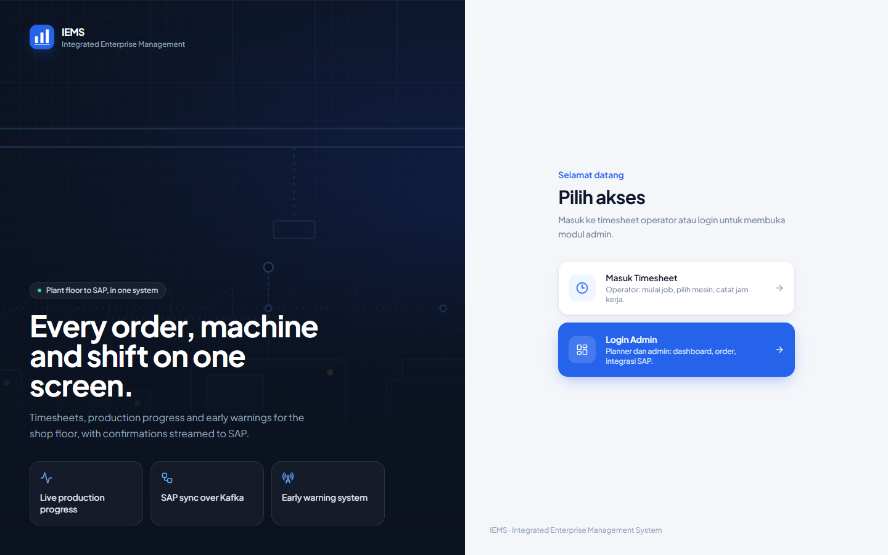
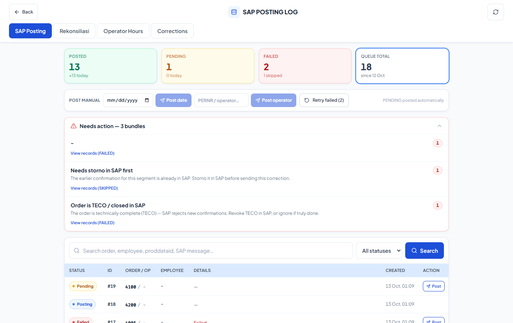
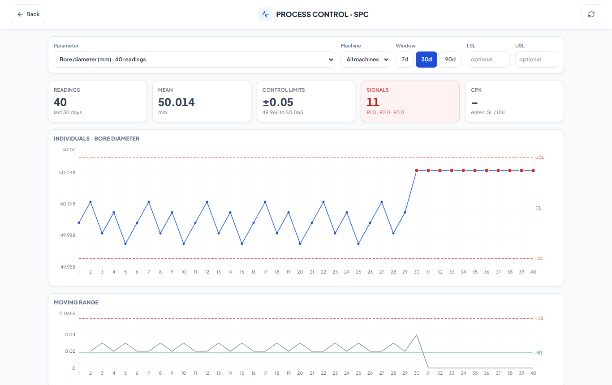

<div align="center">


# IEMS — Integrated Enterprise Management System

**Shop-floor operating system for heavy-equipment manufacturing — turning NFC tap-ins, live machine telemetry, and bay schedules into verified SAP S/4HANA postings across 4 plants.**

[](https://github.com/Javanian/IEMS/releases)
[](LICENSE)
[](https://github.com/Javanian/IEMS/actions/workflows/ci.yml)
[](#at-a-glance)
[](#development-setup)

[](#tech-stack)
[](#tech-stack)
[](#tech-stack)
[](#tech-stack)
[](#tech-stack)
[](#sap-pipeline-script-by-script)

[Why IEMS](#why-iems) · [At a Glance](#at-a-glance) · [Screenshots](#screenshots) · [Features](#what-it-does) · [Architecture](#architecture) · [Engineering Highlights](#engineering-highlights) · [Quick Start](#development-setup)

</div>

---

## Why IEMS?

In heavy-equipment manufacturing, critical factory operations often live in disconnected silos: operators fill paper timesheets, machine hours sit in separate HMI databases, workshop bays get scheduled on spreadsheets, and supervisors manually re-enter production confirmations into SAP.

**IEMS unifies the entire shop-floor lifecycle into one offline-capable platform** — from an operator tapping an NFC badge at a kiosk, to automated machine-hour ETL, real-time early-warning voice alerts on the factory floor, statistical quality control (SPC), and **exactly-once posting into SAP S/4HANA**.

Designed and built solo as the company's sole internal developer: system architecture, frontend PWA, backend APIs, database schema, Docker infrastructure, Kafka messaging, and SAP CPI integration.

> [!NOTE]
> This repository is a curated public snapshot of the production codebase. Credentials, plant data exports, internal planning notes, and non-runtime tooling are excluded, so it does not connect to live plant systems out of the box.

---

## At a Glance

| Metric | Scope |
| :--- | :--- |
| **Production Footprint** | **4 plant sites** running daily on isolated, offline-first factory LANs |
| **Per-Plant Stack** | **16 services per site** via Docker Compose (+ optional Kafka transport workers) |
| **Frontend Application** | **142 React 19 components & views**, offline-first PWA with bundled fonts & design tokens |
| **Database & Schema** | **101 SQL migrations** on PostgreSQL 15 behind PgBouncer connection pooling |
| **Automation & Workers** | **30 Python scripts** handling SQL Server ETL, SAP staging/posting, Kafka relay, and local Piper TTS |
| **Reliability Guarantee** | **Zero double-posting** to SAP via DB triggers, partial unique indexes, and idempotent Kafka keys |

---

## Screenshots

Captured from a local run using representative sample data.

| Sign-in | Operator Kiosk (NFC Timesheet) |
| :---: | :---: |
|  |  |
| *Split-screen authentication with the IEMS design system* | *Touch-friendly shop-floor kiosk for NFC check-in & job operations* |

| SAP Posting Queue & Operations Log | Statistical Process Control (SPC) Dashboard |
| :---: | :---: |
|  |  |
| *Live staging totals, retry/correction controls & audit trail* | *I-MR control chart with automated Nelson rules (1–3) & Cp/Cpk* |

---

## What It Does

| Module | Capabilities |
| :--- | :--- |
| **Labor Timesheet** | NFC-card login, check-in/check-out per job operation, hierarchical supervisor validation, and Excel export |
| **Machine Hours ETL** | Automated extraction from factory SQL Server & HMI sources: segment splitting, normalization, per-shift bundling, and validation |
| **SOW & Bay Scheduling** | Work-order pool, visual bay reservations on an area map and timeline, NFC confirmation, and sub-operation progress tracking |
| **Early Warning System** | Periodic OEE, OLE, and adoption snapshots; tablet uptime via kiosk heartbeats & HMI uptime via ping logs; threshold-based issue detection; real-time SSE notifications and **local Piper TTS voice alerts** on the shop floor |
| **SAP S/4HANA Integration** | Staging of labor timesheets and machine-hour bundles, automated posting to SAP CPI, safe retry, correction workflow, and operations queue UI — with optional **Apache Kafka** transport for orders and confirmations |
| **Component Tracking** | Buffer transactions, receiving & shipment tracking, consumables/tools management, and kanban boards |
| **Process Control & SPC** | Per-job process parameters, I-MR control charts with Nelson rules 1–3, and Cp/Cpk capability indices against optional specification limits |
| **Executive & Plant Dashboards** | Live visibility into active orders, TECO status, machine productive time, pending validations, OEE, and OLE |

---

## Architecture

<picture>
  <source media="(prefers-color-scheme: dark)" srcset="https://raw.githubusercontent.com/Javanian/IEMS/main/docs/diagrams/iems-architecture-dark.svg">
  
</picture>

The Kafka paths (dashed, through the two topics) activate when running with the `kafka` Docker Compose profile. Each diagram in [docs/diagrams](docs/diagrams) is rendered from a companion JSON spec pinning the exact source files and line ranges behind every box.

Each plant runs its own self-contained stack of **16 services** (plus Kafka workers when enabled). All frontend assets and fonts are bundled locally so the entire platform operates smoothly on a factory LAN **without internet access**.

### Repository Layout

```text
apps/
  web/                React 19 + Vite 7 + Tailwind 3 (PWA, offline-first)
  api/                Node.js / Express REST API
  fastapi-msproject/  FastAPI service for MS Project synchronization
  tts-worker/         Python local text-to-speech worker (Piper)
jobs/
  etl/                Machine-hours ETL from factory SQL Server
  sap_staging/        SAP pipeline: stage, post, operations queue, Kafka relay & poster
  messaging/          Kafka envelope, topics, producer/consumer helpers, E2E tests
  sow/                SOW seed and export utilities
  machine_ping/       Machine & HMI heartbeat worker
database/
  migrate.js          SQL migration runner
  migrations/         101 SQL migrations (api, deferred, legacy)
infra/nginx/          Reverse proxy & TLS configuration
docker-compose.yml    Full per-plant production stack
```

---

## Engineering Highlights

- **Exactly-once SAP payroll & machine posting:** Every bundle records its exact source segments. A partial unique index allows each segment to be `POSTED` only once, and a database trigger freezes source fields after posting. Retries trigger strictly on network failures — never on SAP business rejections — making retries after a lost response completely safe.
- **Partitioned Kafka transport ([design notes](jobs/messaging/README.md)):** Confirmations are keyed by production order so SAP CPI's per-order lock is respected naturally via Kafka partitioning rather than brittle application locks. Scaling poster replicas increases throughput linearly, while row references and payload hashes drop late or duplicate deliveries. SAP orders flow through a compacted topic that each plant consumes at its own pace and can replay from the beginning.
- **Decoupled stage / post / ops workers:** Staging, posting, and manual operator actions (retry/correction) run as separate workers, with UI buttons writing commands into `sap_ops_request` for `ops_worker.py` to execute safely.
- **Connection-pooled multi-worker database:** The Express API and Python background workers share PostgreSQL 15 through **PgBouncer**, keeping connection overhead predictable under shop-floor load.
- **Offline-first design system with CI enforcement:** The UI follows a unified token system ([design-system/iems/MASTER.md](design-system/iems/MASTER.md)) using CSS variables instead of raw hex colors (enforced in CI) with locally bundled `Plus Jakarta Sans` and `Fira Code` fonts.
- **Zero-cloud shop-floor voice alerts:** Early-warning announcements synthesize locally using **Piper TTS**, avoiding any dependency on external cloud APIs.
- **Drift-sensitive SPC statistics:** The SPC engine estimates $\sigma$ from the average moving range ($\overline{MR}$) rather than overall standard deviation, keeping control limits tight when a machining process begins to drift.

---

### Lifecycle of an SAP Confirmation

Each staged row transitions through a strict state machine. Claiming a row into `POSTING` happens in a single atomic `UPDATE`, ensuring two competing workers never post the same record, while database guards turn any would-be duplicate into `SKIPPED`.

<picture>
  <source media="(prefers-color-scheme: dark)" srcset="https://raw.githubusercontent.com/Javanian/IEMS/main/docs/diagrams/sap-confirmation-lifecycle-dark.svg">
  
</picture>

### SAP Pipeline, Script by Script

<details open>
<summary><strong>Part 1 — Machine data to the staging queue</strong></summary>

`etl_machine_conf.py` copies raw HMI segments from SQL Server into `mch_productiondata`, `etl_mch_transaction_v3.py` resolves operator, production order, and status into `mch_transaction`, and `sap-stage-worker` runs `stage_machinehours.py` to bundle eligible rows per day into `sap_timesheet_staging` while recording source-segment provenance.

<picture>
  <source media="(prefers-color-scheme: dark)" srcset="https://raw.githubusercontent.com/Javanian/IEMS/main/docs/diagrams/sap-pipeline-staging-dark.svg">
  
</picture>

</details>

<details open>
<summary><strong>Part 2 — Staging queue to SAP S/4HANA</strong></summary>

`post_sap_staging.py` claims rows, validates two duplicate guards (`sap_staging_source` and `log_timesheet_sap`), and posts to SAP CPI. With `SAP_TRANSPORT=kafka`, `sap_kafka_relay.py` and `sap_kafka_poster.py` route confirmations through `sap.confirmations.v1`. Actions from the SAP Log UI enqueue requests executed by `ops_worker.py`.

<picture>
  <source media="(prefers-color-scheme: dark)" srcset="https://raw.githubusercontent.com/Javanian/IEMS/main/docs/diagrams/sap-pipeline-posting-dark.svg">
  
</picture>

</details>

---

## Tech Stack

| Layer | Technologies |
| :--- | :--- |
| **Frontend** | React 19, Vite 7, Tailwind CSS 3 (CSS-variable design tokens), Plus Jakarta Sans & Fira Code (bundled), React Router, ECharts, Recharts, dnd-kit, `vite-plugin-pwa` |
| **Backend** | Node.js 18+, Express 4, FastAPI |
| **Data** | PostgreSQL 15, PgBouncer, SQL Server (factory HMI ETL source) |
| **Messaging** | Apache Kafka (KRaft), `confluent-kafka` (`librdkafka`) with idempotent producers, compacted topics & dead-letter topics |
| **Workers** | Python (SQL Server ETL, SAP staging & posting, Kafka producers/consumers, Piper local TTS) |
| **Infrastructure** | Docker Compose, Nginx with TLS, Linux |
| **Enterprise Integration** | SAP S/4HANA via SAP CPI, Microsoft Project |

---

## Development Setup

```bash
# 1. Install dependencies
cd apps/web && npm install
cd ../api && npm install
cd ../..

# 2. Configure environment variables
cp .env.example .env            # adjust database & service values

# 3. Start PostgreSQL & PgBouncer, then run migrations
docker compose up -d db pgbouncer
node database/migrate.js

# 4. Run API (port 3001) and Web UI (port 5173) in separate terminals
cd apps/api && npm run dev
cd apps/web && npm run dev
```

### Production Deployment (Per Plant Site)

```bash
# Standard per-plant stack
docker compose up -d --build

# Optional: enable Apache Kafka broker, confirmation relay/poster & order consumer
docker compose --profile kafka up -d --build
```

ETL and SAP worker configuration variables are documented in `.env.example`.

---

## Automated Tests

GitHub Actions executes **4 CI jobs** on every push:
1. **API unit tests** (`node --test`)
2. **Web production build** (`vite build` + design-token checks)
3. **Python unit tests** (ETL, SPC & messaging helpers)
4. **End-to-end Kafka pipeline test** against live `apache/kafka` and PostgreSQL containers

The E2E test replaces SAP CPI with a local mock HTTP server to verify that every confirmation reaches SAP **exactly once** across 3 competing poster replicas, no two confirmations for the same production order are ever in flight concurrently, rows per order arrive strictly in sequence, and replayed/unparsable/in-flight messages post nothing. See [jobs/messaging/README.md](jobs/messaging/README.md#tests) to run it locally.

---

## Limitations of This Public Snapshot

- Automated test coverage focuses on the SAP messaging pipeline, SPC statistics, and core units; most UI pages and standard CRUD routes are not covered by automated tests.
- Workers connecting to SQL Server, SAP CPI, or MS Project require live enterprise endpoints and credentials that are excluded from this repository.
- Some UI labels intentionally mix Indonesian and English to match shop-floor operator terminology.

---

## License

This project is licensed under the **MIT License** — see the [LICENSE](LICENSE) file for details. Production data and internal company configurations are not included in this repository.

---

## Author

**Tee San** ([Javanian](https://github.com/Javanian)) — Full-Stack Developer & Data Engineer  
[Portfolio](https://porto.hillteo.com) · [teesanfajar@gmail.com](mailto:teesanfajar@gmail.com)
