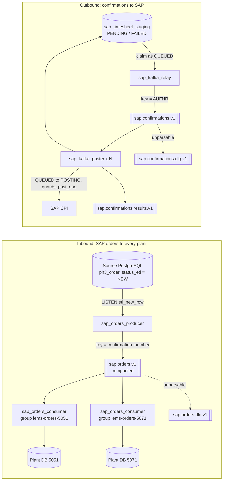

# Kafka messaging for the SAP integration

IEMS exchanges two kinds of data with SAP S/4HANA:

- **Inbound:** production orders and operations (`ph3_order`) that SAP writes into a source PostgreSQL database. Every plant database needs them.
- **Outbound:** labor and machine-hour confirmations from `sap_timesheet_staging`, posted to SAP through SAP CPI. This is the payroll path.

Both can run over Kafka. PostgreSQL stays the source of truth; Kafka is the transport between the database that has the data and the workers that need it. The direct mode (`etl_sync_v2.py`, `post_sap_staging.py`) still works and is the default.



## Topics

| Topic | Key | Partitions | Retention | Content |
| --- | --- | --- | --- | --- |
| `sap.orders.v1` | confirmation number (leading zeros stripped) | 6 | compacted | Latest state of every SAP operation |
| `sap.orders.dlq.v1` | original key | 1 | 30 days | Order events that could not be parsed |
| `sap.confirmations.v1` | order number (AUFNR) | 6 | 14 days | Requests to post one staging row |
| `sap.confirmations.results.v1` | order number | 6 | 14 days | Outcome per row: POSTED, FAILED or SKIPPED |
| `sap.confirmations.dlq.v1` | original key | 1 | 30 days | Confirmation requests that could not be parsed |

Every value uses one JSON envelope with `event_id`, `event_type`, `schema_version`, `occurred_at`, `producer` and `data`. A consumer rejects an unknown type or version instead of guessing.

## Why each design choice

**Order number as the confirmation key.** SAP CPI locks a production order while it books a confirmation, so a second confirmation for the same order sent at the same time is rejected with "Order X is already being processed". The direct poster handles this by grouping rows per order in threads. With Kafka the key does it: all messages for one order land in one partition, and a partition is read by one consumer at a time. Orders are posted one after another, different orders in parallel, and adding poster replicas (up to the partition count) adds throughput without any locking code.

**The message is a reference, not the payload.** A confirmation message carries the staging id and a SHA-256 of the payload. The poster re-reads the row and posts only if it is still `QUEUED` and the hash matches. A message that arrives late, twice, or after the source record was corrected can therefore never post stale data.

**New status `QUEUED`.** The relay moves rows to `QUEUED` and records the status they came from. The polling poster's automatic run only claims `PENDING` and `FAILED` rows, and the relay never claims a row that is `POSTING` or already `QUEUED`. Whichever worker moves a row to `POSTING` first is the only one that sends it; any other copy of the request finds the row in a different state and is dropped. The invalidation trigger treats `QUEUED` like `PENDING`, so correcting a source record still deletes its unsent bundle. If the broker does not acknowledge a message, its row goes straight back; if a row stays `QUEUED` too long (default 6 hours), the relay restores it and publishes it again.

**Compacted order topic.** Kafka keeps the latest event for every confirmation number indefinitely. A plant that was offline continues from its last offset, and a new plant database is filled by starting a consumer group from the beginning.

**Offsets after the database.** Consumers commit their offset only after their database transaction has committed. A crash in between redelivers the batch, which is harmless because every write is an idempotent upsert or a conditional status change.

**All anti-double-post guards stay in PostgreSQL.** The partial unique index on posted segments, the burned-ZTIMESHEETID check and the freeze trigger described in [`jobs/sap_staging/README.md`](../sap_staging/README.md) apply unchanged. The relay runs the guards when it claims rows and the poster runs them again right before posting.

## Delivery guarantees

| Failure | What happens |
| --- | --- |
| Broker down when the relay publishes | Unacknowledged rows return to their previous status and are retried next cycle |
| Relay stops after claiming, before publishing | Rows stay `QUEUED` until the requeue timeout, then return to their previous status |
| Poster stops after posting, before committing the offset | The message is redelivered, the row is no longer `QUEUED`, the message is dropped |
| Consumer group rebalances during processing | The offset commit fails and is logged; the new owner gets the message and drops it as stale |
| Admin re-sends a row that is being posted | The relay skips rows in `POSTING` or `QUEUED`, so the row is not queued twice |
| Source record corrected while queued | The invalidation trigger deletes the bundle; the poster finds no row and drops the message |
| Unparsable message | Copied to the DLQ topic with the error, source partition and offset in headers; processing continues |
| PostgreSQL down while consuming | The consumer rewinds to the failed offset and retries until the database is back |

## Running it

```bash
# Database change (QUEUED status, queue columns, invalidation trigger)
node database/migrate.js

# Broker, topics, relay, poster and the order consumer for this plant
docker compose --profile kafka up -d --build

# Switch UI posting actions (Post selected, Retry failed, Post date ...) to Kafka
# by setting SAP_TRANSPORT=kafka in .env, then rebuild the ops worker (its image now
# includes confluent-kafka) and stop the polling poster:
docker compose up -d --build sap-ops-worker
docker compose stop sap-post-worker

# More parallel orders
docker compose --profile kafka up -d --scale sap-kafka-poster=3

# At the one site that can reach the SAP source database, instead of etl_sync_v2.py
docker compose --profile kafka --profile kafka-source up -d sap-orders-producer

# Optional web UI for topics and consumer lag on http://127.0.0.1:8088
docker compose --profile kafka --profile kafka-ui up -d kafka-ui
```

The relay accepts every flag of `post_sap_staging.py`, so manual runs work the same way:

```bash
python sap_kafka_relay.py --ids 123,124          # publish selected rows
python sap_kafka_relay.py --failed-only          # publish FAILED rows again
```

For a managed cluster (Confluent Cloud, Amazon MSK, Aiven), point `KAFKA_BOOTSTRAP_SERVERS` at it and set `KAFKA_SECURITY_PROTOCOL`, `KAFKA_SASL_MECHANISM`, `KAFKA_SASL_USERNAME` and `KAFKA_SASL_PASSWORD`. Set `KAFKA_REPLICATION_FACTOR=3` before creating topics on a multi-broker cluster.

## Files

| File | Role |
| --- | --- |
| `iems_kafka.py` | Envelope, topic definitions, producer and consumer configuration, publish-with-acknowledgement, DLQ, consumer loop |
| `create_topics.py` | Creates missing topics with their settings |
| `../sap_staging/sap_kafka_relay.py` | Claims staging rows, runs guards, publishes to `sap.confirmations.v1` |
| `../sap_staging/sap_kafka_poster.py` | Consumes confirmations and posts them to SAP |
| `../etl/sap_orders_producer.py` | Publishes new SAP order rows from the source database |
| `../etl/sap_orders_consumer.py` | Applies order events to one plant database |
| `../etl/order_sync_core.py` | Order upsert shared with `etl_sync_v2.py`, so both modes write identical rows |
| `../../database/migrations/api/20261012_sap_staging_kafka_queue.sql` | `QUEUED` status, queue columns, updated invalidation trigger |

## Tests

```bash
# No broker needed: envelope, publish acknowledgement, keys, hashing, order mapping
python -m unittest discover -s jobs/messaging/tests -p "test_unit.py" -v

# Real Kafka and a disposable PostgreSQL database; SAP CPI is replaced by a local HTTP
# server that fails the test if two confirmations for one order are in flight at once
export KAFKA_BOOTSTRAP_SERVERS=localhost:9092
export IEMS_TEST_DB_HOST=localhost IEMS_TEST_DB_PORT=5432 IEMS_TEST_DB_NAME=iems_it
export IEMS_TEST_DB_USER=iems_test IEMS_TEST_DB_PASSWORD=iems_test
python -m unittest discover -s jobs/messaging/tests -p "test_integration.py" -v
```

The integration test stages rows for several orders, a row without an order, a row whose segment was already posted, a row for another plant and a row SAP rejects. It runs three posters in one consumer group and checks that every row reaches SAP exactly once, that no two confirmations for one order overlap, that rows of one order arrive in staging order, that a replayed message and an unparsable message do not post anything, that results reach the results topic, and that stuck rows are restored. The inbound test checks plant routing, zero stripping, newest-version-wins and the DLQ. GitHub Actions runs both against `apache/kafka` and PostgreSQL service containers.
